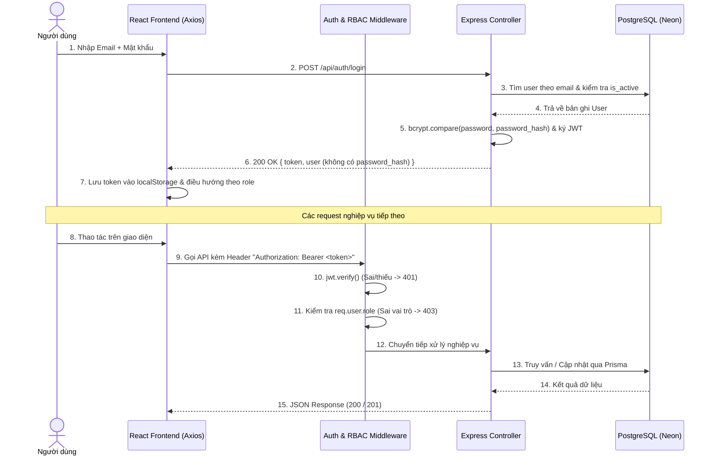
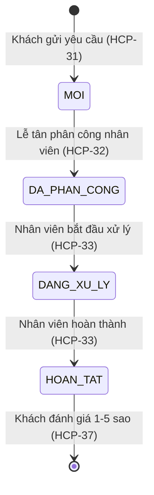
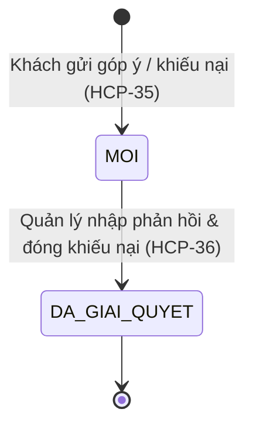

# Tài Liệu Kiến Trúc Hệ Thống (System Architecture)

- **Mã công việc Jira:** `HCP-47`
- **Tên dự án:** Hệ thống cổng chăm sóc khách hàng cho khách sạn (**HotelCarePortal**)

---

## 1. Tổng Quan Kiến Trúc 3 Tầng (Three-Tier Architecture)

Hệ thống được thiết kế theo mô hình **Client – Server RESTful API 3 tầng** tách biệt hoàn toàn giữa giao diện người dùng, tầng xử lý nghiệp vụ và tầng cơ sở dữ liệu:

1. **Tầng Giao diện (Presentation Layer — `/frontend`):**
   - Xây dựng bằng **React 19 + Vite 8 + Tailwind CSS v4** theo mô hình Single Page Application (SPA).
   - Quản lý trạng thái đăng nhập qua `AuthContext` và bảo vệ tuyến đường ở phía client bằng `ProtectedRoute`.
   - Giao tiếp với Backend qua `axios` kèm Interceptor tự động đính kèm header `Authorization: Bearer <token>` và tự động đăng xuất khi nhận mã `401`.
2. **Tầng Nghiệp vụ (Application / API Layer — `/backend`):**
   - Xây dựng bằng **Node.js + Express 5**, tổ chức theo mô hình **Route → Middleware (Auth / RBAC / Validation) → Controller → Prisma ORM**.
   - Đảm nhiệm kiểm tra hợp lệ dữ liệu đầu vào (`express-validator`), xác thực JWT (`authenticate`), phân quyền theo 4 vai trò (`authorize`), và xử lý quy trình trạng thái yêu cầu dịch vụ.
3. **Tầng Dữ liệu (Data Layer — PostgreSQL trên Neon):**
   - Lưu trữ dữ liệu quan hệ trên **PostgreSQL 16 (Neon Serverless)** với 8 bảng có ràng buộc khóa ngoại và khóa duy nhất (`@unique`).

---

## 2. Sơ Đồ Triển Khai Đám Mây (Cloud Deployment Diagram)

```mermaid
flowchart LR
    subgraph Client["Người dùng (Trình duyệt Desktop / Mobile)"]
        U1["🛎️ Khách lưu trú (GUEST)"]
        U2["🏨 Lễ tân (RECEPTIONIST)"]
        U3["🔧 Nhân viên (STAFF)"]
        U4["📊 Quản lý (MANAGER)"]
    end

    subgraph Vercel["Vercel Cloud (Frontend SPA)"]
        FE["React 19 + Vite + Tailwind v4\n(vercel.json SPA Rewrite)"]
    end

    subgraph Render["Render Cloud (Backend Web Service)"]
        CORS["CORS + Express JSON"]
        AUTH["Middleware JWT & RBAC"]
        CTRL["Controllers (10 User Stories)"]
        PRISMA["Prisma Client ORM"]
        CORS --> AUTH --> CTRL --> PRISMA
    end

    subgraph Neon["Neon Serverless (Database)"]
        DB[("PostgreSQL 16\n8 Bảng dữ liệu")]
    end

    Client -->|"HTTPS"| FE
    FE -->|"REST API (HTTPS + Bearer JWT)\nVITE_API_URL"| CORS
    PRISMA -->|"Connection Pool (SSL)\nDATABASE_URL"| DB
```



---

## 3. Luồng Xác Thực JWT & Phân Quyền RBAC (Sequence Diagram)



---

## 4. Sơ Đồ Quan Hệ Thực Thể Cơ Sở Dữ Liệu (ERD — 8 Bảng)

```mermaid
erDiagram
    USERS ||--o{ STAYS : "guest_id"
    USERS ||--o{ SERVICE_REQUESTS : "assigned_to (Staff)"
    USERS ||--o{ REQUEST_HISTORY : "changed_by"
    USERS ||--o{ FEEDBACKS : "guest_id / handled_by"
    USERS ||--o{ RATINGS : "guest_id"
    ROOMS ||--o{ STAYS : "room_id"
    STAYS ||--o{ SERVICE_REQUESTS : "stay_id"
    SERVICE_CATEGORIES ||--o{ SERVICE_REQUESTS : "category_id"
    SERVICE_REQUESTS ||--o{ REQUEST_HISTORY : "request_id"
    SERVICE_REQUESTS ||--o| RATINGS : "request_id (1-1 unique)"

    USERS {
        int id PK
        string full_name
        string email UK
        string password_hash
        enum role "GUEST | RECEPTIONIST | STAFF | MANAGER"
        boolean is_active
        datetime created_at
    }
    ROOMS {
        int id PK
        string room_number UK
        int floor
        enum type "STANDARD | DELUXE | SUITE | FAMILY"
        enum status "AVAILABLE | OCCUPIED | MAINTENANCE"
    }
    STAYS {
        int id PK
        int guest_id FK
        int room_id FK
        date check_in
        date check_out
    }
    SERVICE_CATEGORIES {
        int id PK
        string name
        string description
    }
    SERVICE_REQUESTS {
        int id PK
        int stay_id FK
        int category_id FK
        string content
        enum status "MOI | DA_PHAN_CONG | DANG_XU_LY | HOAN_TAT | DA_HUY"
        int assigned_to FK
        datetime created_at
        datetime completed_at
    }
    REQUEST_HISTORY {
        int id PK
        int request_id FK
        enum old_status
        enum new_status
        int changed_by FK
        datetime changed_at
    }
    FEEDBACKS {
        int id PK
        int guest_id FK
        enum type "GOP_Y | KHIEU_NAI"
        string content
        enum status "MOI | DANG_XU_LY | DA_GIAI_QUYET"
        string response
        int handled_by FK
        datetime created_at
    }
    RATINGS {
        int id PK
        int request_id FK_UK
        int guest_id FK
        int score "1..5"
        string comment
        datetime created_at
    }
```

---

## 5. Sơ Đồ Trạng Thái Nghiệp Vụ (State Machine)

### 5.1. Vòng đời Yêu cầu dịch vụ (`ServiceRequest`)


### 5.2. Vòng đời Góp ý / Khiếu nại (`Feedback`)

